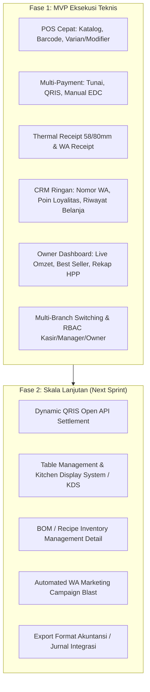

# Product Requirement Document (PRD)
## SaaS POS + CRM + Central Sales Monitoring (UMKM Indonesia)

| Metadata | Details |
| :--- | :--- |
| **Doc ID** | `PRD-SAAS-POS-01` |
| **Product Name** | Omnipoint POS & Central Ops (Working Title) |
| **Target Audience** | UMKM Retail & F&B Indonesia (1 - 20 Cabang) |
| **Document Status** | Approved for Sprint Kickoff |
| **Target Release** | MVP Phase 1 |
| **Document Owner** | Client Operations / Product Lead |

---

## 1. Executive Summary & Problem Statement

### 1.1 Context
Sektor UMKM di Indonesia (khususnya Food & Beverage dan Retail mandiri) menghadapi tantangan digitalisasi operasional harian. Mayoritas pelaku usaha yang memiliki 1 hingga 10 cabang mengalami inefisiensi operasional akibat sistem kasir yang lambat, database pelanggan yang tercecer, dan ketiadaan visibilitas data cabang secara terpusat.

### 1.2 Core Problem Statements
1. **POS Lambat & Terlalu Rumit**: Sistem POS waralaba atau legacy enterprise terlalu berat dan rumit bagi staf kasir dengan perputaran tinggi (turnover kasir UMKM tinggi). Pelatihan kasir baru memakan waktu, dan transaksi peak-hour sering tersendat.
2. **CRM Mati Suri**: UMKM mengumpulkan data kontak pelanggan di buku tamu atau spreadsheet manual yang tidak pernah diolah. Pelanggan enggan men-download aplikasi loyalitas baru hanya untuk satu toko.
3. **Owner Buta Data Cabang**: Pemilik usaha (business owner) harus menunggu laporan manual via chat WhatsApp atau spreadsheet dari outlet manager pada larut malam. Tidak ada live monitoring omzet lintas cabang, lambat mendeteksi kebocoran kasir/fraud, dan sulit menghitung estimasi laba kotor real-time.

### 1.3 Product Vision & Value Proposition
Membangun solusi **All-in-One Cloud SaaS** yang menggabungkan:
- **POS Kasir Cepat**: Interface intuitif, adaptif untuk layar tablet/mobile, siap dalam peak-hour.
- **Frictionless WA-First CRM**: Registrasi loyalitas instan hanya menggunakan nomor WhatsApp (tanpa perlu install aplikasi oleh customer).
- **Central Sales & Profit Monitoring**: Dashboard web & mobile bagi owner untuk memantau performa semua cabang, profitabilitas, serta peringatan anomali penjualan secara real-time.

---

## 2. User Personas

| Persona | Role & Work Environment | Primary Goals | Key Pain Points |
| :--- | :--- | :--- | :--- |
| **1. Siti (Kasir Outlet)** | Gardu depan kasir, perangkat tablet Android/iPad atau POS terminal desktop. | Memproses antrean transaksi secepat mungkin (< 15 detik), cetak struk tanpa eror, kalkulasi kembalian akurat. | Antrean panjang saat peak hour, sistem sering freeze, bingung saat pelanggan minta split bill atau ganti metode bayar. |
| **2. Budi (Outlet Manager)** | Mengelola operasional harian 1 outlet fisik. | Rekap kas harian (shift opening/closing), opname stok barang masuk/keluar, approval refund/void kasir. | Selisih uang kas kecil (cash discrepancy), kasir nakal melakukan void sembarangan, laporan harian makan waktu lama. |
| **3. Hendra (Business Owner / HQ)** | Pemilik 3-10 cabang F&B/Retail, mobile, memantau via smartphone. | Memantau omzet live per cabang, evaluasi produk terlaris, tracking estimasi laba kotor, deteksi cabang berkinerja buruk. | Tidak tahu omzet sebelum tengah malam, laporan manual tidak standar, takut ada kebocoran uang di kasir. |
| **4. Admin SaaS (Superadmin Platform)** | Internal tim SaaS / Operations. | Provisioning tenant baru, manajemen paket langganan (subscription), feature flag, audit log keamanan sistem. | Troubleshooting manual saat data tenant bermasalah, monitoring service health dan gateway billing. |

---

## 3. Core Feature Requirements & User Stories

### 3.1 Module 1: Front-of-House Point of Sale (POS)

#### User Stories:
- *Sebagai Kasir*, saya ingin memilih produk via katalog kategori / barcode scanner dan menyelesaikan pesanan dalam hitungan detik agar antrean tidak menumpuk.
- *Sebagai Kasir*, saya ingin membagi tagihan (split bill) berdasarkan item atau nominal merata agar dapat melayani rombongan pelanggan yang ingin membayar terpisah.
- *Sebagai Pelanggan & Kasir*, saya ingin menerima bukti transaksi via cetak kertas thermal atau pesan WhatsApp otomatis tanpa kertas.

#### Feature Specifications:
1. **Quick Order Engine**:
   - Layout grid sentuh responsif dengan filter kategori, pencarian instan, dan dukungan barcode reader (USB/Bluetooth).
   - Pengaturan Varian produk (Ukuran, Warna, Es/Panas) dan Modifier/Add-on (misal: Extra Topping, Less Sugar).
2. **Multi-Payment Support**:
   - Tunai (Cash) dengan kalkulator uang pas dan kembalian otomatis.
   - Non-Tunai: QRIS (Dinamis per transaksi / Statis), Debit/Kredit EDC manual record, Transfer Bank, dan E-Wallet (GoPay, OVO, ShopeePay, Dana).
   - Multiple tender: Pelanggan bisa membayar sebagian tunai dan sisanya via QRIS.
3. **Split Bill & Merge Bill**:
   - Split by Item: Memindahkan item tertentu ke tagihan baru.
   - Split by Equal Amount: Membagi total tagihan menjadi $N$ pembayaran yang sama besar.
4. **Receipt Generation**:
   - Thermal Printer Bluetooth/USB/Network: Support ukuran kertas 58mm dan 80mm standar industri.
   - WhatsApp Digital Receipt: Integrasi API pengiriman e-struk langsung ke nomor WA pelanggan yang terdata.
5. **Offline-Resilient Operation**:
   - Kasir tetap dapat melakukan input transaksi lokal saat internet terputus menggunakan local storage/IndexedDB.
   - Sinkronisasi otomatis transaksi ke server saat koneksi kembali normal dengan proteksi UUID idempotency.

---

### 3.2 Module 2: Frictionless WhatsApp-First CRM & Loyalty

#### User Stories:
- *Sebagai Kasir*, saya ingin mendaftarkan pelanggan hanya dengan menanyakan nomor WhatsApp tanpa formulir rumit agar proses transaksi tetap cepat.
- *Sebagai Pelanggan*, saya ingin mendapatkan poin loyalitas otomatis dan notifikasi reward via WhatsApp agar saya termotivasi datang kembali.
- *Sebagai Owner*, saya ingin melihat segmentasi riwayat belanja pelanggan untuk merancang promo yang tepat sasaran.

#### Feature Specifications:
1. **Frictionless Customer Identification**:
   - Input nomor telepon (WhatsApp) di layar kasir dengan instant lookup nama pelanggan yang sudah tersimpan.
   - Sistem otomatis membuat profil baru jika nomor belum terdaftar, tanpa menghambat alur checkout.
2. **Loyalty Point & Tiering System**:
   - Akumulasi poin berdasarkan nominal transaksi (contoh default: Rp 10.000 = 1 Poin).
   - Penukaran poin (Redemption) langsung sebagai potongan diskon transaksi di kasir dengan verifikasi OTP cepat via WA / PIN kasir.
   - Status tiering dinamis: Silver, Gold, Platinum berdasarkan total belanja bulanan/tahunan.
3. **Customer Purchase History & RFM Tracking**:
   - Catatan riwayat belanja: Tanggal kunjungan, cabang yang dikunjungi, produk favorit, rata-rata belanja (AOV).
   - Metrik RFM dasar (*Recency, Frequency, Monetary*) yang otomatis mengelompokkan pelanggan: *New, Active Loyal, At-Risk, Inactive*.
4. **Targeted WhatsApp Notification (Add-on)**:
   - Pengiriman ucapan selamat ulang tahun dengan voucher diskon otomatis.
   - Notifikasi perolehan poin dan saldo poin terbaru setelah transaksi selesai.

---

### 3.3 Module 3: Owner Dashboard & Central Sales Monitoring

#### User Stories:
- *Sebagai Owner*, saya ingin melihat total penjualan hari ini secara live feed di HP saya agar selalu tahu performa bisnis di mana pun saya berada.
- *Sebagai Owner*, saya ingin membandingkan omzet, jam sibuk, dan produk terlaris antar cabang dalam satu layar.
- *Sebagai Owner*, saya ingin melihat ringkasan estimasi laba kotor berdasarkan HPP (Harga Pokok Penjualan) agar tidak hanya fokus pada omzet kotor.

#### Feature Specifications:
1. **Live Feed Omzet & Transaksi**:
   - Real-time widget total penjualan kotor (Gross Sales), diskon, penjualan bersih (Net Sales), dan jumlah transaksi hari ini.
   - Auto-refresh via WebSocket atau polling berkala (interval 30 detik).
2. **Multi-Branch Comparative Analytics**:
   - Leaderboard cabang: Urutan cabang dari omzet tertinggi ke terendah.
   - Peta jam sibuk (Hourly Sales Heatmap) per cabang untuk optimasi jadwal kerja staf.
   - Top 10 Best Selling Products dan Slow Moving Items.
3. **Profit & Margin Monitoring**:
   - Integrasi HPP per item produk.
   - Perhitungan otomatis Laba Kotor (Gross Profit) = Net Sales - Total HPP.
   - Pemisahan Pajak Restoran/Daerah (PB1 10%) dan Service Charge dari pendapatan usaha.
4. **Automated Daily Closing Push Notification**:
   - Rekap otomatis pada akhir jam operasional (misal: 23:00) yang dikirim ke WhatsApp owner: Total omzet, pembayaran tunai vs digital, void/diskon abnormal, dan persentase pencapaian target.

---

## 4. Business Rules, Security & Edge Cases

### 4.1 Shift Control & Cash Reconciliation
- **Shift Opening**: Kasir wajib menginput modal awal kas (Cash Float).
- **Shift Closing (Laporan X/Z)**: Kasir menginput hitungan fisik kas di laci kasir (blind closing). Sistem menampilkan selisih (over/short) hanya setelah manager mengonfirmasi.

### 4.2 Void, Refund, and Discount Authorization
- Setiap pembatalan pesanan setelah masuk dapur/proses, penghapusan item (void), atau diskon manual di luar promo wajib memerlukan input **PIN Supervisor / Outlet Manager**.
- Seluruh event void dan refund tercatat dalam audit log permanen beserta alasan (*misal: pesanan salah, pelanggan membatalkan*).

### 4.3 Tax & Service Charge Rules
- Konfigurasi flexible per cabang: Apakah harga menu sudah termasuk pajak (*Inclusive Tax*) atau belum termasuk (*Exclusive Tax*).
- Kalkulasi PPN 11% (Retail) atau PB1 10% (F&B) dan Service Charge diterapkan sebelum atau sesudah diskon sesuai standar akuntansi Indonesia.

### 4.4 Data Isolation & Multitenancy Security
- Pemisahan data multi-tenant yang ketat (Row-Level Security pada database). Cabang A tidak boleh dapat melihat data kasir Cabang B kecuali akun dengan role Owner/HQ.
- Role-Based Access Control (RBAC):
  - `Cashier`: Akses POS terminal, buka/tutup shift sendiri, tidak bisa lihat laba/HPP.
  - `Outlet Manager`: Akses POS + Backoffice outlet, approval void/refund, laporan shift cabang.
  - `Business Owner`: Akses penuh semua outlet, analitik finansial, setting HPP, ekspor laporan.
  - `Superadmin`: Akses tenant management, billing langganan, tanpa akses intip data sensitif pelanggan.

---

## 5. Non-Functional Requirements (NFR) & Success Metrics

### 5.1 Success Metrics (KPI)

| Metric | Target Goal | Measurement Method |
| :--- | :--- | :--- |
| **Transaction Speed (POS)** | Rata-rata $\le 15$ detik per transaksi | Waktu antara penambahan item pertama sampai struk terbit / pembayaran sukses. |
| **Peak Throughput** | Minimal 4 transaksi/menit per kasir | Pengujian stres saat simulasi antrean jam makan siang. |
| **CRM Capture Rate** | $\ge 45\%$ transaksi terasosiasi no. WA | Total transaksi dengan nomor member terisi dibagi total transaksi. |
| **Stock Accuracy** | Discrepansi stok fisik vs sistem $\le 1.5\%$ | Hasil audit stock opname mingguan. |
| **Owner Retention & NPS** | Net Promoter Score (NPS) $\ge 55$, Monthly Churn $< 3\%$ | Survey kepuasan owner bulanan dan renewal rate langganan SaaS. |

### 5.2 Technical & Performance Standards
- **System Availability**: 99.9% Uptime cloud service.
- **Latency**: API response time $\le 200$ ms untuk endpoint pencarian katalog dan posting transaksi.
- **Offline Tolerance**: Mampu menyimpan hingga 1.000 transaksi antrean lokal per terminal jika internet terputus, dan otomatis sinkron tanpa duplikasi begitu koneksi pulih.

---

## 6. Implementation Scope (MVP vs Future Roadmap)

- **In-Scope (Fase 1 - Mulai Besok Pagi)**:
  - POS Mobile/Web responsif (Katalog, Diskon, Split Bill, Multi-payment, Thermal Print, Sinkronisasi Offline).
  - WA-First Member Register & Basic Loyalty Point System.
  - Central Sales Dashboard (Live sales feed per cabang, Top Produk, Margin Kotor, Shift Report).
  - Manajemen Cabang & User Management (Kasir, Manager, Owner).
- **Out-of-Scope (Ditunda ke Fase 2)**:
  - Kitchen Display System (KDS) terpisah untuk koki dapur.
  - Integrasi delivery marketplace aggregator (GrabFood/GoFood sync).
  - Modul akuntansi pembukuan neraca lengkap (Balance Sheet & Cash Flow).
