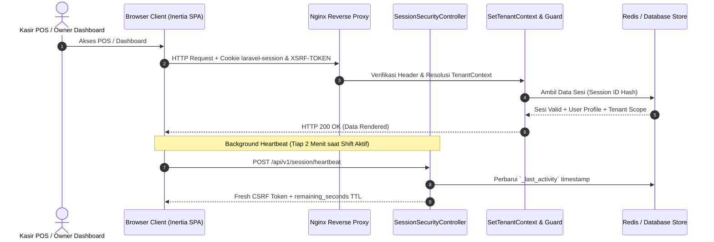

# Arsitektur Sistem, Keamanan Sesi & Tata Kelola Data QLon (2026)

Dokumen ini mendokumentasikan secara menyeluruh arsitektur sistematis, logika keamanan sesi, manajemen cookies, rotasi token, dan tata kelola kedaulatan data platform **QLon POS & CRM SaaS**.

---

## 1. Arsitektur Sesi, Cookies & Token Keamanan (Enterprise Tier)



### 1.1. Matriks Keamanan Cookie Sesi
| Nama Cookie | Domain / Path | Atribut Keamanan | Fungsi & Mitigasi |
| :--- | :--- | :--- | :--- |
| `laravel-session` | Host / `/` | `HttpOnly=true`, `SameSite=Lax`, `Secure` | Menyimpan identitas sesi terenkripsi di server (Redis/DB). `HttpOnly` memblokir akses JavaScript pihak ketiga untuk mencegah pencurian sesi via Cross-Site Scripting (XSS). |
| `XSRF-TOKEN` | Host / `/` | `HttpOnly=false`, `SameSite=Lax`, `Secure` | Token anti-CSRF yang dibaca Axios/Fetch untuk disertakan pada header `X-XSRF-TOKEN`. Mencegah serangan pemalsuan permintaan lintas situs (CSRF). |

### 1.2. Logika Rotasi Sesi & Idle Timeout
1. **Regenerasi Sesi Saat Login (`session()->regenerate()`):**
   - Mencegah serangan *Session Fixation* di mana penyerang menetapkan session ID sebelum korban masuk.
2. **Idle Lifetime & Heartbeat Asinkron:**
   - Default idle timeout: 120 menit.
   - Terminal POS kasir dilengkapi dengan endpoint otomatis `POST /api/v1/session/heartbeat` dan `GET /api/v1/session/status` yang memperbarui timestamp aktivitas saat kasir sedang memproses transaksi pada jam sibuk festival, sehingga laci kasir dan antrean tidak pernah terputus tiba-tiba oleh 419 Page Expired.
3. **Penyimpanan Multi-Driver:**
   - Siap beroperasi dengan driver `redis` (kinerja memori sub-milidetik untuk event ramai) atau `database` (PostgreSQL session table).

---

## 2. Kedaulatan Multi-Tenant & Zero-Leakage Data Scope

```mermaid
graph TD
    Client[Permintaan Klien: Kasir / Owner] --> AuthMiddleware[Otentikasi Akun]
    AuthMiddleware --> TenantMW[SetTenantContext Middleware]
    TenantMW --> BindContext[TenantContext::set(tenant_id)]
    BindContext --> EloquentScope[TenantScope Global Filter]
    EloquentScope --> PG[(PostgreSQL DB: where tenant_id = current)]
```

- **Pemisahan Logis Penuh:** Seluruh model transaksi, inventaris, pelanggan CRM, dan invoice terikat dengan `TenantScope`.
- **Mode Sovereign Master Administrator:** Akun superadmin global memiliki wewenang memantau metrik agregat seluruh tenant tanpa merusak batasan data isolasi masing-masing tenant.

---

## 3. Brand Identity & Logo SVG Vektor

Logo resmi QLon dirancang dalam format vektor SVG murni (`QlonLogo.tsx`) tanpa ketergantungan aset raster:
- **Simbol:** *Torus Loop Continuous 'Q'* dengan aksen *Forward Sync Terminal Node*, merepresentasikan aliran kasir berkecepatan tinggi, stabilitas transaksi festival, dan siklus CRM pelanggan.
- **Palet Warna Utama:**
  - Biru Navy Primer: `#0f2b5c`
  - Biru Navy Royal: `#1e4488`
  - Electric Cyan Pulse: `#0284c7` & `#38bdf8`
  - Soft Canvas: `#f8fafc`
- **Zero Emoji:** 100% dipasangkan dengan icon semantik Lucide.

---

## 4. Sistem Halaman Hukum Resmi (Edisi 2026)

Telah dibangun dua halaman hukum terstruktur yang dapat diakses publik maupun dari dalam aplikasi:
1. **Syarat dan Ketentuan Layanan (`/terms`):**
   - Mengatur 7 pilar: Definisi platform 2026, Akun Tenant & Keamanan Sesi, Layanan POS Kasir & Event Concurrency, Transaksi Keuangan & Cetak Struk ESC/POS, CRM & WhatsApp Gateway, SLA Ketersediaan 99.9%, serta Batasan Tanggung Jawab.
2. **Kebijakan Privasi & Perlindungan Data (`/privacy`):**
   - Mengatur kepatuhan penuh terhadap UU Perlindungan Data Pribadi (UU PDP 2026) dan standar ISO 27001, klasifikasi data, retensi snapshot harian, dan hak penghapusan data tenant (*Right to be Forgotten*).
3. **Fitur Antarmuka:** Navigasi cepat *sticky table of contents*, pencarian klausul seketika, dan tombol cetak/PDF ramah peramban.

---

## 5. Sistem Gerak & Micro-Interactions (Framer Motion)

Antarmuka QLon kini diperkaya dengan sistem animasi fisika alami menggunakan `framer-motion`:
- **Card Hover Elevation:** Efek tactile melayang halus saat kursor melintas di atas kartu analitik dan produk.
- **Micro-interactions:** Sliding segmented pill switcher pada halaman login/register dengan kurva bezier kustom.
- **Live Security Badge:** Indikator denyut hijau (*pulse glow*) pada dashboard menandakan status koneksi sesi terenkripsi secara real-time.

