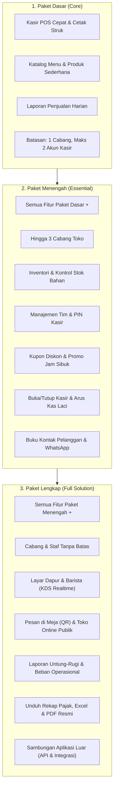

# Rencana Implementasi: Sistem Paket Fitur Modular & Bahasa Simpel Netral

> **Tujuan:** Mengubah arsitektur sistem POS & CRM menjadi modular berbasis paket langganan (**Dasar / Core**, **Menengah / Essential**, **Solusi Lengkap / Full Solution**), serta mengganti seluruh istilah teknis (*techy jargon*) menjadi **Bahasa Indonesia Netral & Simpel** yang ramah bagi pemilik usaha, manajer, kasir, dan staf dapur.

---

## 1. Kamus Istilah: Dari Techy Jargon ke Bahasa Simpel Netral

Seluruh antarmuka aplikasi disesuaikan agar tidak ada lagi istilah asing yang rumit bagi pengusaha dan tim operasional:

| Istilah Teknis Lama | Bahasa Simpel Netral (Baru) | Penjelasan untuk Pengguna |
| :--- | :--- | :--- |
| **Sovereign Command Center** | **Pusat Pengaturan Aplikasi** | Ruang kendali pemilik aplikasi memantau seluruh toko dan server. |
| **Tenant / Multi-Tenant** | **Toko / Bisnis Terdaftar** | Usaha atau bisnis milik pengguna yang menggunakan aplikasi. |
| **Kitchen Display System (KDS)** | **Layar Dapur & Barista** | Layar antrean pesanan masak tanpa kertas untuk koki dan barista. |
| **Developer PaaS & Webhooks** | **Sambungan Aplikasi Luar** | Fitur menghubungkan data toko ke sistem kasir luar / aplikasi pihak ketiga. |
| **Shift Reconciliation** | **Rekap Kas Laci (Tutup Kasir)** | Pencocokan uang fisik di laci kasir dengan catatan transaksi sistem. |
| **Stock Opname / Adjustment** | **Penyesuaian Stok Barang** | Catatan barang masuk baru, stok basi/rusak, atau barang hilang. |
| **P&L / OPEX Expense Tracking** | **Laporan Untung-Rugi & Biaya Toko** | Pemasukan penjualan dikurangi modal dan biaya harian (listrik, sewa, gaji). |
| **PB1 Restaurant Tax** | **Laporan Pajak Usaha Resto** | Rekap nilai pajak daerah yang siap diserahkan untuk pelaporan pajak. |
| **RFM Customer Segmentation** | **Kelompok Pelanggan** | Pengelompokan pembeli: Pelanggan Setia, Pelanggan Biasa, dan Pelanggan Baru. |
| **Emergency Delegation Token** | **Izin Bantuan Teknis Sementara** | Kunci izin resmi dari pemilik toko agar admin aplikasi bisa bantu perbaikan. |

---

## 2. Struktur Modul & Pilihan Paket Fitur Usaha

Mirip hak akses karyawan (RBAC), tetapi diatur pada level **Paket yang Dipilih oleh Toko**. Pemilik Aplikasi dapat mengatur paket tiap toko dengan satu klik:

### Rincian Modul per Paket:

| Modul Fitur | Paket Dasar (*Core*) | Paket Menengah (*Essential*) | Paket Lengkap (*Full Solution*) |
| :--- | :---: | :---: | :---: |
| **Terminal Kasir POS & Cetak Struk** | Ya | Ya | Ya |
| **Katalog Produk & Kategori** | Ya | Ya | Ya |
| **Ringkasan Penjualan Hari Ini** | Ya | Ya | Ya |
| **Buka/Tutup Shift Laci Kasir** | — | Ya | Ya |
| **Kontrol Stok Bahan & Peringatan Habis** | — | Ya | Ya |
| **Manajemen Tim & Hak Akses Staf** | — | Ya (Maks 10 staf) | Ya (Tanpa batas) |
| **Banyak Cabang Toko (*Multi-Outlet*)** | — (1 Cabang) | Ya (Maks 3 Cabang) | Ya (Tanpa batas) |
| **Kupon Diskon & Promosi Usaha** | — | Ya | Ya |
| **Buku Kontak Pelanggan WhatsApp & Poin** | — | Ya | Ya |
| **Layar Dapur & Barista (KDS Realtime)** | — | — | Ya |
| **Pesan Mandiri QR Meja & Toko Online** | — | — | Ya |
| **Laporan Untung-Rugi & Biaya Operasional** | — | — | Ya |
| **Unduh Laporan Format Excel & PDF Pajak** | — | — | Ya |
| **Sambungan Sistem Luar (*Integrasi API*)** | — | — | Ya |

---

## 3. Desain Teknis Implementasi

### A. Skema Basis Data (`tenants`)
Tambahkan kolom paket dan modul di tabel `tenants`:
- `subscription_tier`: enum (`core`, `essential`, `full`) — default: `essential`.
- `custom_modules`: json nullable — jika ada toko yang membeli modul tambahan secara terpisah (misal paket Core tapi beli add-on Layar Dapur).
- `max_outlets`: integer (default sesuai paket).
- `max_staff`: integer (default sesuai paket).

### B. Helper & Trait: `HasPackageEntitlement`
Pada model `Tenant`:
- `hasModule(string $module): bool`: Memeriksa apakah modul aktif untuk toko tersebut berdasarkan paket atau custom modules.
- `canAddOutlet(): bool`: Memeriksa apakah kuota cabang masih mencukupi.
- `canAddStaff(): bool`: Memeriksa apakah kuota karyawan masih mencukupi.

### C. Middleware Keamanan: `CheckModuleEntitlement`
Jika pengguna mencoba membuka rute modul yang tidak aktif pada paketnya (misal membuka `/kitchen` pada paket `core`), sistem akan:
- Memberikan pemberitahuan ramah: *"Fitur Layar Dapur & Barista tersedia di Paket Solusi Lengkap. Hubungi Pemilik Aplikasi untuk mengaktifkan modul ini."*
- Mengarahkan kembali ke Dasbor tanpa error teknis.

### D. Tampilan Menu Sidebar Dinamis (`app-shell.tsx`)
- Menu samping hanya menampilkan modul yang aktif pada paket toko tersebut agar layar bersih dan tidak membingungkan karyawan.
- Pemilik Toko (*Owner*) melihat lencana kecil paket usahanya di pojok kiri bawah: `Paket Usaha: Menengah (Essential)` dengan tombol informatif untuk melihat fitur yang dapat ditingkatkan.

### E. Pengaturan Paket oleh Pemilik Aplikasi (`/superadmin`)
- Di panel Superadmin pada tabel toko, ditambahkan dropdown cepat:
  `[ Paket: Dasar | Menengah | Solusi Lengkap ]`.
- Superadmin dapat mengubah paket toko mana pun dalam 1 detik tanpa reload halaman.

---

## 4. Rencana Kerja Bertahap (Task Plan)

- [ ] **Tahap 1: Migrasi Database & Logika Paket**
  - Tambahkan kolom `subscription_tier`, `custom_modules`, `max_outlets`, `max_staff` pada tabel `tenants`.
  - Buat helper `Tenant::hasModule(string $module)`.
  - Tulis unit test untuk memvalidasi batasan tiap paket.

- [ ] **Tahap 2: Middleware & Penyederhanaan Bahasa di Backend**
  - Buat middleware `CheckModuleEntitlement`.
  - Pasang guard pada controller: `KitchenDisplayController`, `FinanceController`, `OnlineOrderController`, `DeveloperHubController`.
  - Ganti seluruh pesan error/flash message yang bernada techy menjadi kalimat Bahasa Indonesia netral.

- [ ] **Tahap 3: Implementasi Modul Layar Dapur & Barista (`/kds`)**
  - Buat halaman khusus dapur tanpa kertas struk.
  - Tampilkan kartu pesanan masuk (Meja, instruksi masak, timer durasi pengerjaan).
  - Tombol aksi ramah sentuhan: *Mulai Masak* $\rightarrow$ *Selesai / Siap Antar*.

- [ ] **Tahap 4: Ekspor Laporan Excel & PDF Akuntansi**
  - Tambahkan tombol unduh Excel (.csv/.xlsx) dan PDF cetak resmi pada halaman Laporan Penjualan dan Laba Rugi.
  - Format tabel bersih standar pembukuan UMKM & pelaporan pajak daerah (PB1).

- [ ] **Tahap 5: Panel Kendali Paket di Superadmin & Sidebar Dinamis**
  - Tampilkan pengubah paket di `/superadmin` (ganti paket toko langsung).
  - Sesuaikan menu samping di `app-shell.tsx` agar menyembunyikan modul yang tidak aktif sesuai paket.
  - Perbarui graf ketergantungan menggunakan MCP Ruas (`npx @fk0u/ruas index .`).
